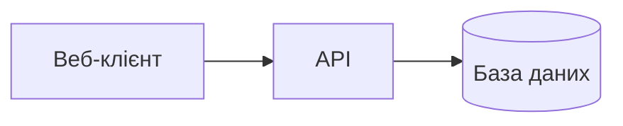
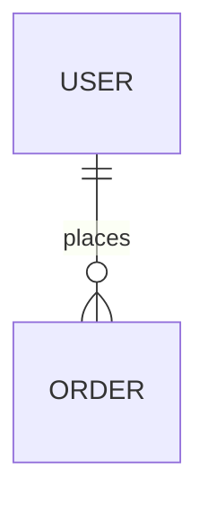

# Архітектура: {назва проєкту}

> **Вхід:** `docs/03-spec.md` · **Автор:** агент архітектор

## 1. Контекст (C4, рівень 1)

## 2. Контейнери (C4, рівень 2)

## 3. Технології

| Шар | Вибір | Чому | ADR |
|---|---|---|---|
| | | | ADR-001 |

## 4. Модулі та межі

| Модуль | Відповідає за | Тека в коді | Від кого залежить |
|---|---|---|---|
| | | `app/src/...` | |

## 5. Модель даних

## 6. Карта інтерфейсів

Контракт між модулями. Розробник змінює інтерфейс лише через нове рішення архітектора.

| Модуль | Публічний інтерфейс (функція / endpoint / подія) | Сигнатура | Хто використовує |
|---|---|---|---|
| | | | |

## 7. Розгортання

- **Де працює:**
- **Як збирається:**
- **Конфігурація й секрети:** {змінні середовища, без значень}
- **Як відкотити:**

## 8. Залежності

Повний список бібліотек проєкту. Їх встановлює таск-каркас, інші таски нових пакетів не додають.

| Пакет | Версія | Навіщо |
|---|---|---|
| | | |

## 9. Команди

Шляхи — відносно `projects/<slug>/`.

| Дія | Команда | Звідки запускати |
|---|---|---|
| Встановити залежності | | `app/` |
| Підготувати робочу копію таска (worktree) | {наприклад: встановити залежності або зробити посилання на них з основної копії} | `app/` у копії |
| Наповнити тестовими даними | | `app/` |
| Запустити локально (URL, порт) | | `app/` |
| Тести | | `app/` |
| Лінтер | | `app/` |

**Тести мають бути ізольованими:** без фіксованих портів (порт 0 або випадковий), кожен прогін зі своєю тимчасовою базою чи файлами. Кілька агентів запускають тести одночасно.

## 10. Рішення (ADR)

| ID | Рішення | Статус |
|---|---|---|
| ADR-001 | | прийнято |
